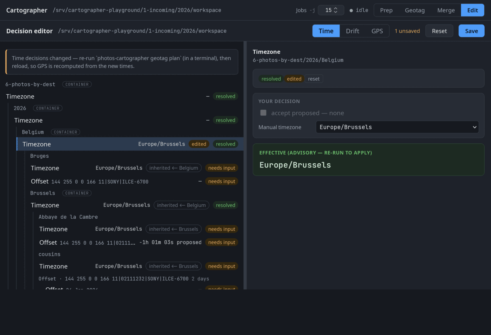

# photos-cartographer

[](https://github.com/sigfridvonshrink/photos-cartographer/releases/latest)
[](https://github.com/sigfridvonshrink/photos-cartographer/releases/latest)
[](LICENSE)

**Put a whole photo library — or a single trip's dump — on the map, with the least manual work.**

*Native GPS where you have it, GPX tracks where they help, minimal, manual cascading fallbacks everywhere else.*

photos-cartographer takes an unorganized dump of photos and videos, cleans and date-organizes it, then
**places every shot on the map** by making the most of every real location it can find: it keeps the
**native GPS** your camera/phone already wrote, **correlates the rest to GPX tracks** — *first inferring and
correcting each camera's clock error automatically*, so a camera set to the wrong timezone or drifting by
minutes still lands on the right point of the track — and **cascades a manual folder-level fallback** over
whatever's left. Even a library with no tracks at all still gets a complete map, from a handful of
manually-set folder pins offered down the folder tree. Nothing is deleted and nothing is changed without a plan
that can be inspected first, and **every position it writes is marked, in the photo itself, with how it was
found** — `matched` on a track point, `interpolated` between two, `extrapolated` past a track's end, or set by
hand for the photo or by its folder's fallback. A position the camera wrote itself is kept as it is.

The aim is **100% geolocation coverage for the least possible effort**: every photo placed — precise where the tracks
allow, rough or manual where they don't — so a map view in a library like Immich shows your **whole library**,
not just the frames that came with a location baked in.

But, also, **nothing** is worse than making an irreversible mess of your photo archive. I have been there.
This is why this script is terminally paranoid about safety: dry runs, no-clobber moves, stale-plan rejection,
crash recovery, idempotent re-runs, dependency fingerprints, provenance logs and behaviour test coverage are included.



*The decision editor: time → drift → GPS.* **▶ [The full run, step by step →](docs/quickstart.md)**

*Screenshot from v2.0.0: the Time view now also asks which country a destination is in, and where tracks lie by
the photos, a clock offset taken from the timezone is no longer accepted there first — it is confirmed once, against
the track, in the Drift view.*

It is built for **irreplaceable originals and large batches**: a whole holiday or a years-deep library, several cameras and phones,
thousands of RAW and JPEG frames — resolved in one reviewable pass instead of photo-by-photo, then merged
cleanly into a permanent **folder-based photo library** (digiKam, or anything that reads a plain folder tree).
Almost all of the code that writes time/GPS metadata into photo files — the geotag phase — is exercised by a thorough
automated test suite, and every rule of the specification is named by a test that fails when it is broken (figures
in [`COVERAGE.md`](COVERAGE.md)), so a change that would misbehave is caught before it can touch a photo.

> **Searches that might land here:** how to *geotag photos with no GPS from a GPX track*,
> *correlate photos to a GPS track when the camera time is wrong*, *batch/bulk geotag thousands of RAW photos
> non-destructively*, *auto-detect a camera clock offset / timezone for geotagging*, *geolocate a whole
> photo library / put every photo on the map (map-complete library)*, *rough or approximate geotag without
> a GPX track*, *cascading folder-level location*, or a scriptable
> **GeoSetter / HoudahGeo / gpscorrelate / darktable alternative** for an entire trip at once.

## Is it for you? Four choices

It rests on four deliberate choices. Agree with them and it's probably for you; don't, and it isn't — simple.

1. **Photos are irreplaceable, so they deserve care** — no original is ever lost or silently altered;
   correctness beats convenience.
2. **A local, owned, folder-based library** — a plain directory tree on disk (digiKam, Immich, anything
   that reads folders), not a cloud service or a proprietary catalog.
3. **Ask only what the data can't settle** — everything derivable is resolved automatically; you're asked
   only the human judgment calls that are absolutely needed, each made easy to answer.
4. **Every photo on the map, even when GPS is scarce** — precise where the tracks allow, rough or manual
   where they don't; a *map-complete* library, not just the frames that came with a pin.

The reasoning — and the architecture these four force — is **[Who is this for?](docs/who-is-this-for.md)**.

## How it works in one minute

A clean **prep → geotag → merge** pipeline built around the one decision only you can make. Geotag resolves
everything *it* can on its own, in an order chosen so each supplied answer unlocks the most automatic work
downstream:

1. **Prep** — consolidate the dump, normalize extensions, detect duplicates (quarantined, never deleted), and
   date-organize everything.
2. **Sort** *(the one step only you can do)* — move photos from `5-photos-by-date` into a destination tree of
   places (`2026/France/Paris/Louvre`, …). This isn't just tidiness: a photo's destination decides its
   **timezone**, its **GPS fallback**, and **where it lands in the library** — so a wrong folder means a wrong
   time or place. A destination has **one timezone**: photos taken in another belong in a folder of their own.
   Prep must record the sort before geotag plans; when the inbox (`0-sources`) is empty and recording it moves
   no file, `geotag plan` runs prep for you. Then geotag takes over:
3. **Timezone** — say which **country** a destination is in, once, high in the tree: a country with one
   timezone gives it to every destination inside. Elsewhere you pick the zone once and the folders inside
   inherit it; your configured default zone is **offered, never assumed**. A phone photo that records another
   offset than the zone's makes geotag ask instead of guess.
4. **Clock offset** — for each camera and day, infer the clock error by matching the frames the camera
   geolocated itself against the GPX tracks. Where several agree it applies itself (by default), and it carries
   over to the camera's photos of the same day in its other destinations. A camera with no position of its own
   that day starts from the destination's timezone, which you **confirm once, against the track** (or accept,
   where no track lies near). Phones get no clock question: their time is read with the offset they record,
   else by the destination's timezone.
5. **Place** — geotag every frame the tracks can cover: **matched** to a track point, **interpolated** between
   two, or **extrapolated** a bounded distance off an end. Each track file — and each track inside one — is used
   on its own, never joined to another or bridged across a recording break.
6. **Remainder** — whatever no evidence can locate is collected into a short, explicit worklist: place it by
   hand, give its folder a **fallback position** (set once, offered to the folders below), or knowingly leave
   it without one — nothing is left off the map by accident.
7. **Merge** — move the finalized set into the permanent folder-based library, with a full transformation log.

Every phase **plans before it acts**, and only a validated plan ever writes: prep and merge have a dry-run of
the saved plan, and geotag's plan changes no photo. Re-runs act on the diff and are resumable after a crash.

## Install and run

photos-cartographer ships as one self-contained executable, attached to each
[GitHub Release](https://github.com/sigfridvonshrink/photos-cartographer/releases/latest) together with
`photos-config-defaults.json`, the editable defaults a new workspace's configuration is seeded from. Keep the two
side by side. The executable needs a `python3` on the host and the tools under [Requirements](#requirements).

```bash
gh release download --repo sigfridvonshrink/photos-cartographer \
    --pattern 'photos-cartographer' --pattern 'photos-config-defaults.json'
chmod +x photos-cartographer
./photos-cartographer edit --demo        # look around first: a read-only tour, no workspace needed
```

Every command works on the **current directory** as its workspace. Bare `photos-cartographer` lists the phases,
`photos-cartographer <phase>` lists its commands, and `-h` on any command gives its options. A run, in short,
with the executable on your `PATH`:

```bash
cd /path/to/working-folder               # a folder of its own on one filesystem, holding only your dump
photos-cartographer prep plan            # then: prep dry-run, prep execute
# move photos from 5-photos-by-date/ into a tree of places under 6-photos-by-dest/
photos-cartographer geotag plan          # then: photos-cartographer edit, Save, geotag plan again — until it is ready
photos-cartographer geotag execute
photos-cartographer geotag finalize
photos-cartographer merge init-library   # once, to mark the library merge writes into
photos-cartographer merge plan           # then: merge dry-run, merge execute
```

Review `.photos-ingest/photos-00-config.json` after the first `prep plan`: it is seeded from the defaults, then
belongs to the workspace, and names every setting itself — a setting missing from it, or one cartographer does not
know, stops the run, named. `photos-cartographer console` runs and watches every one of these commands from a
browser instead. The **[quick start](docs/quickstart.md)** walks through each step.

### Upgrading from v2.0.0

- Replace a deployed `photos-config-defaults.json` with this release's.
- A workspace begun under v2.0.0 is refused until its `photos-00-config.json` is brought up to date. Add the
  settings that now each bound one thing — `gpx_tracks_agree_max_distance_meters`,
  `gpx_anchor_max_segment_gap_seconds`, `gpx_anchor_same_pass_max_seconds`, `gpx_anchor_stay_max_seconds`,
  `gpx_anchor_stay_distance_meters`, `gpx_anchor_decision_tolerance_seconds`, `gpx_extrapolation_heading_seconds`,
  `gpx_extrapolation_max_distance_meters`, `gpx_extrapolation_max_speed_kmh`,
  `clock_offset_same_day_max_difference_seconds` and `drift_check_track_window_seconds` (the error names each with
  its default) — and remove `photo_anchor_interpolation_max_gap_seconds` and
  `photo_anchor_extrapolation_max_seconds`.
- Then run `prep plan` and `prep execute`: fingerprints now cover every frame and stream, so every file is
  fingerprinted once more — a slow run, once — and geotag and merge refuse the old handoff until then.
- Clock offsets you accepted are asked again: an acceptance now names the offset it accepted. A timezone that came
  from your configured default is asked again too — the default is now only offered (one click in the editor).
- The library itself needs nothing.

## Documentation

- **[Is this for you? — and why it's built this way](docs/who-is-this-for.md)** — the seven roots (three
  facts about photos, four design choices) and the architecture they force. Read it **forward** to decide
  fit, or **down** to see the design rationale. Start here if you're weighing whether the tool matches your
  situation.
- **[See it work (walkthrough)](docs/walkthrough.md)** *(obsolete: shows v2.0.0, to be redone)* — the **full run end to end, in screenshots**: prep →
  sort → geotag's time → drift → GPS edit loop → merge, with a flow diagram.
- **[Quick start](docs/quickstart.md)** — download → prerequisites → the full end-to-end run (prep, sort into
  destinations, the geotag time → drift → GPS loop, execute, merge). Start here to run it.
- **[Concepts](docs/concepts.md)** — the *why*: camera groups, per-day clock offsets, the by-dest tree, clock
  offset vs. GPS drift, and what cascades down the folder tree.
- **[Editor guide](docs/editor.md)** — driving the browser decision editor: the three views, validating drift,
  placing GPS, shift-click multi-select, and how edits reset/cascade.
- **[How this compares](docs/comparison.md)** — HoudahGeo, GeoSetter, gpscorrelate, darktable, exiftool and
  others, side by side.

The authoritative behavioral specification lives in [`spec/`](spec/) and is published, rendered and
cross-linked, at **[sigfridvonshrink.github.io/photos-cartographer](https://sigfridvonshrink.github.io/photos-cartographer/)** — what each phase guarantees
([shared](https://sigfridvonshrink.github.io/photos-cartographer/intent/shared.html), [prep](https://sigfridvonshrink.github.io/photos-cartographer/intent/prep.html), [geotag](https://sigfridvonshrink.github.io/photos-cartographer/intent/geotag.html),
[merge](https://sigfridvonshrink.github.io/photos-cartographer/intent/merge.html)), [why](https://sigfridvonshrink.github.io/photos-cartographer/rationale/philosophy.html), and
[the tests that verify each rule](https://sigfridvonshrink.github.io/photos-cartographer/_generated/tests.html). See *How it works (the detail)* below.

## Decide in the browser

The decisions geotag can't make alone are made in a **small local web app** you start with
`photos-cartographer edit` (or open in the console's Edit tab) — no build step, no CDN; only the map tiles and
the place search need the network. It shows a worklist of only the open decisions, each with its proposal and
the evidence, and writes your choice into the durable records geotag reads (the **edit → Save → `geotag plan` →
reload** loop; it only ever touches the `user_decision` field). Three views: **Time** (each destination's
country and timezone, inherited down the destination tree, and the clock offsets to accept or set), **Drift**
(scroll a photo along its GPX track until it lines up — the app reads the corrected clock offset off the track),
and **GPS** (place a shot on an interactive map, paste a `lat, lon`, set a folder's fallback position, or leave
a photo knowingly without one). Clicking on a map and recording every decision in writing are the same act — and
because each re-run re-reads the records, nothing is lost. An answer is asked again only when what it answered
has changed: an accepted clock offset records the offset it accepted, so a new proposal asks anew.

→ See the **[editor guide](docs/editor.md)** for depth.

## Why it's different from GeoSetter, HoudahGeo, gpscorrelate, darktable

Those tools are excellent **interactive correlators**, but they share two assumptions this pipeline removes:

- **They trust the camera clock.** Correlating photos to a GPX track only works if the camera's time is right;
  when it isn't, the offset has to be discovered and typed in by hand, per camera, per trip.
  photos-cartographer **infers the offset automatically** — it matches the frames a camera geolocated itself
  against the track and solves for the clock error, then geotags the rest from that. A camera with no position
  of its own is started from the destination's timezone and checked once against the track.
- **They work one import, one photo, one map-click at a time.** This pipeline is **batch, plan-driven, and
  safety-first**: it plans the whole job, saves the exact operations for inspection, and only then writes —
  never overwriting an original, recoverable by design.

If the offsets are already known and clicking each photo onto a map is fine, the classic tools are great. For
a pile of mixed-clock photos that need *correct placement with the least possible effort*, that is what this
is for. → For the **full tool-by-tool comparison** (HoudahGeo, GeoSetter, Geolignment, gpscorrelate,
darktable, exiftool, Lightroom, cloud), see **[How this compares](docs/comparison.md)**.

**Still deciding?** [Who is this for?](docs/who-is-this-for.md) distills it to the fewest questions that
settle fit — three facts about photos, four design choices — and traces the architecture they force.

## Designed to ask for the least

It treats geotagging as a **constraint-propagation problem**: resolve everything the data can, then ask only
for the **minimal set of human decisions** — *ordered so each answer unlocks the most automatic work
downstream*. Timezone first (a country, said once high in the tree, often settles it), then infer each camera's
clock offset against the tracks, then place everything placeable, then a short worklist of the true remainder.
Decisions are **reused, not re-asked**: a timezone set on a parent destination **cascades** to its children
unless overridden, and manual coordinates/offsets are remembered across re-runs. What the data settles applies
itself — an inherited timezone, a clock offset several of the camera's own positions agree on, a position from
the camera or the tracks — and a proposal that needs your word costs one click to accept. A guess is never
applied silently: your configured default timezone is only offered, and an inherited folder fallback is only
proposed. So one well-placed answer high in the tree can let the pipeline solve every camera on its own.
→ **[Concepts](docs/concepts.md)** for the full model.

## Safety: non-destructive and traceable

Photos are irreplaceable, so the whole design is **plan → validate → execute**:

- **No mutation outside a plan.** Planning never touches a photo; execution applies only a validated plan whose
  preconditions still hold. **The dry-run summarizes the real saved plan** — not a separate simulation. A plan
  goes stale when anything it was built on changes, and is refused until it is made again; execute never writes
  over a photo edited since its plan, and merge refuses a photo changed since finalize.
- **No clobber; quarantine, not delete.** No operation overwrites existing media; duplicates move to a
  recoverable quarantine, never auto-removed. Every rewritten file is synced to disk before it replaces the
  earlier one.
- **Idempotent & resumable.** Re-runs act only on the diff; a crash mid-run is recoverable; already-placed
  files are recognized and skipped.
- **Stable identity.** Each photo's identity is a fingerprint of its decoded content — every frame of an image,
  every stream of a video — unchanged by metadata writes and renames, so its full history stays attached across
  every transformation. Only a library file that is the photo byte for byte counts as already there: the same
  picture in a file with other metadata is held back, both files named, neither removed, for you to settle.
- **Reversible & traceable.** An original-values ledger keeps what each photo held before geotag first changed it,
  and every plan decides from it, so any decision can be withdrawn; and finalize writes a per-photo
  **transformation log** — every clock offset, resolved UTC, timezone, how each position was found (the
  camera's own, matched, interpolated, extrapolated, set by hand, or a folder's fallback) and rename, each linked
  to the decision that caused it, carried forward by merge with the final library path.
- **Stops rather than guesses.** Where something cannot be settled safely, the run stops — before it touches
  a photo — names what it found and says what to do: an entry at the workspace's top level that does not belong
  there (its place is the inbox, `0-sources`), a link or a hidden folder among the photos, a photo prep could not
  fingerprint, a local time that a daylight-saving change skips or repeats (give the photo's time its offset, or
  move the photo out), a tracks folder that is configured but missing, or holds no track that can be read.

## How it works (the detail)

The pipeline is **specification-driven** — behavior is defined by the specification in
[`spec/`](spec/), and the code follows it. The specification is a corpus of linked items — what the tool
guarantees (`spec/intent/`), why (`spec/rationale/`) and how this build does it (`spec/build/`) — rendered and
checked by `tools/spec-build` and published at
**[sigfridvonshrink.github.io/photos-cartographer](https://sigfridvonshrink.github.io/photos-cartographer/)**, in four
documents at each level: the shared contract — the facts all phases share: the run lock, the `.photos-ingest/` control
directory, the configuration, formats, the tracks and the operator loop — then prep, geotag and merge; the
rationale adds the [philosophy](spec/rationale/philosophy.md) ([rendered](https://sigfridvonshrink.github.io/photos-cartographer/rationale/philosophy.html)), the roots the design follows from. Start with
**[`spec/README.md`](spec/README.md)** for how the specification is organized and its discipline.

## Requirements

The pipeline is **Python 3** and shells out to a few standard command-line tools (it doesn't bundle them):

- **exiftool** — reads and writes photo time/GPS metadata (run as a persistent `-stay_open` worker).
- **ImageMagick** (`magick` / `identify`) — the decoded-pixel fingerprint, over every frame, that gives each
  photo a stable identity across metadata writes and renames, plus the editor's photo previews.
- **ffmpeg** — the fingerprint of a video, over every stream, used to de-duplicate videos.

SQLite (the cache and decision database) comes in through Python's standard library, so there's nothing extra
to install for it. Timezones and the list of countries come from the zone database Python reads — the system's,
or the `tzdata` package. Tracks are read as GPX; a track file of another format (`.kml`, `.kmz`, `.fit`, `.tcx`,
`.nmea`, `.igc`) found in the dump or the managed folders stops prep, so keep tracks out of them, where `gpx_root` points.

A workspace lies on **one filesystem**, and that filesystem and the library's need only what POSIX filesystems
share: file locks, an atomic rename, a move that refuses a taken name, and syncing to disk. **ZFS** is optional:
when configured, each execute can take a snapshot before it changes anything, but the safety model — journal,
recoverable quarantine, no-clobber, filesystem-as-truth — stands on its own without it. The decision editor
vendors its front-end (Leaflet — no CDN, no build step); its map tiles and place search use
OpenStreetMap/Nominatim at runtime and degrade gracefully offline.

## Layout

- `cartographer/` — the pipeline package: `photos_1_prep.py` / `photos_2_geotag.py` /
  `photos_3_merge.py` (the three phases) + `photos_utils.py` (shared `CONFIG` + utilities) + `cli.py`
  (the combined `photos-cartographer` entry) + `editor/` (the locally-served Time/Drift/GPS decision app — a map-based web UI — that drives the worklist above) + `console/` (the operational web console: run and monitor every phase from a browser over the cwd workspace).
  Run a phase with `python3 -m cartographer <phase> <subcommand>` (from the repo root),
  or build the self-contained `photos-cartographer` zipapp with `tools/build-pyz`.
- `docs/` — the user guides listed above. `spec/` — the authoritative specifications. `tests/` — the test suite.
  `tools/` — build + test helpers. `.githooks/` — pre-commit / pre-push.
- [`BACKLOG.md`](BACKLOG.md) — what is open. [`HISTORY.md`](HISTORY.md) — why, and every release.

## Tests and coverage

The geotag phase — the one that writes time and GPS into irreplaceable originals — is the most heavily
tested. Coverage is tracked on two axes — line/branch and **spec** (which items of the specification a test
verifies; every rule has one, and the corpus build fails on a rule no test verifies) — both reported in **[`COVERAGE.md`](COVERAGE.md)**; the published corpus lists [every test beside the rules it verifies](https://sigfridvonshrink.github.io/photos-cartographer/_generated/tests.html).

Run the suite from the repository root (`conftest.py` puts the repo root on `sys.path`):

```bash
python3 -m pytest -q
```

See `AGENTS.md` for the full build/test/CLI contract and the seeded config defaults.

## Why this exists

I built this after years of frustration with geotagging photos by hand: typing in offsets, clicking shots onto
a map one at a time, and still ending up with gaps. It does the tedious parts automatically and asks only for
what it truly can't work out, so geotagging a whole trip stops being a chore. It's made first for my own
archive and shared as-is, in case it's useful to anyone with the same problem.

## AI disclosure

The **design and specifications are mine**; the **implementation is AI-written**. The design documents
were turned into the behavior specifications in [`spec/`](spec/), a corpus of rules each stating one
obligation: every rule is named by a test, and the corpus build fails on any rule no test verifies — so the
AI-written code is held to a human-authored spec and verified mechanically. Full statement:
**[`AI-DISCLOSURE.md`](AI-DISCLOSURE.md)**.

## License

Apache License 2.0 — see [`LICENSE`](LICENSE) and [`NOTICE`](NOTICE). The bundled Leaflet library keeps
its own BSD-2-Clause license (`cartographer/editor/web/vendor/leaflet/LICENSE`).
