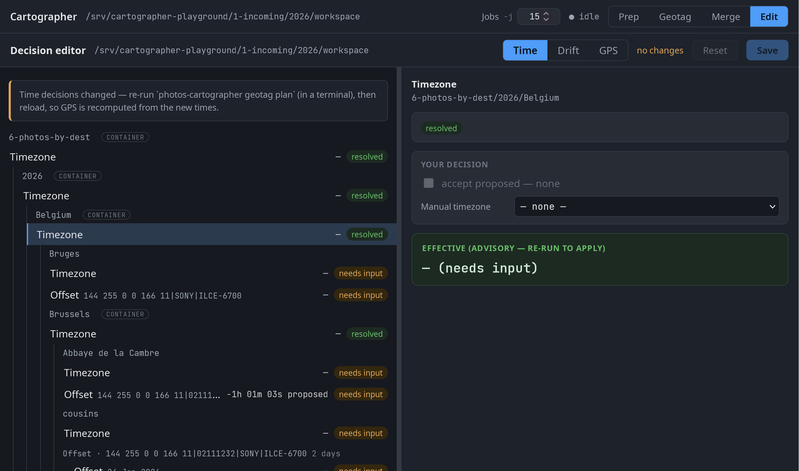
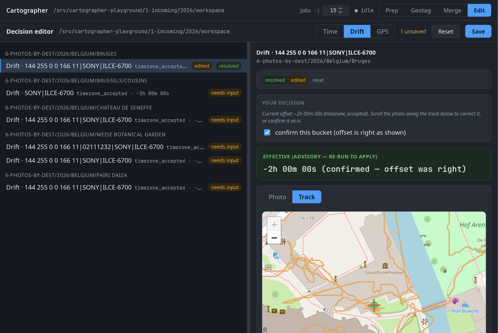

# Concepts

The ideas behind photos-cartographer — *why* the pipeline is shaped the way it is, and what it does
when something is not as it should be. Read this once and the [quick start](quickstart.md) and the
[editor guide](editor.md) will make sense. For the safety model see the [main README](../README.md); the
behaviour described here is defined by [the specification](../spec/README.md), which you can [read online](https://sigfridvonshrink.github.io/photos-cartographer/). For the tool comparison,
see [How this compares](comparison.md).

---

## The workspace and its numbered folders

All work happens inside a **workspace**: a transient working area, separate from your permanent photo
library, on one filesystem. A workspace begins the first time you run `prep` in a folder: `prep plan`
creates a hidden control folder `.photos-ingest/` (configuration, plans, decision files, journals, the
workspace database — the track points geotag decided by among what it holds — and a disposable memo of the
fingerprints prep's planning computed; no phase ever takes anything in it for a photo), and the first `prep execute`
creates the
managed folders and moves the dump into the inbox.

The managed folders, by number:

```
0-sources/           the inbox: a dump lands here; prep empties it after every run
1-strays/<plan-id>/  non-media set aside per run (structure preserved, inert)
2-missing-metadata/  media with no recorded time, until you give it one
3-redundant-jpgs/    JPEGs that sit beside a RAW of the same name
4-videos-by-date/    timed videos, in YYYY-MM-DD/ day folders
5-photos-by-date/    timed photos, in YYYY-MM-DD/ day folders
6-photos-by-dest/    YOU curate this: photos sorted into destination folders
```

The top level holds only these folders, `.photos-ingest/`, the quarantine `.photos-ingest-quarantine/`
and other hidden entries. Anything else there is a misplaced dump and stops every phase.

`prep` does the mechanical work — consolidate, normalize extensions, set duplicates aside (to a
recoverable quarantine, never deleted), name each file by its recorded time and organize by date —
landing photos in `5-photos-by-date/`. **You** then move photos into `6-photos-by-dest/`; that curation
is the one creative step the tool can't do for you, and it's what every later phase reasons about. It is
**load-bearing, not cosmetic**: a photo's destination fixes its timezone, which camera-clock correction
applies to it, its GPS fallback, and its final library location — so a wrong folder produces a wrong
time or place, not just a misfiled photo. (A `prep` run after sorting records the move before geotag —
see the [quick start](quickstart.md#then-re-run-prep).)

### What you may change by hand

Every execution records the state it leaves the workspace's files in — each file's path, size,
modification time and inode, in the workspace database — and every plan, dry run, execute and finalize
first compares the files with it, by those entries alone (no file is read, so it is quick). What a person
is expected to do passes:

- put a dump into `0-sources/` (the inbox is never compared);
- move photos from `5-photos-by-date/` into `6-photos-by-dest/`, move them between destinations, rename a
  destination's folder;
- edit the configuration and the decision files (they keep checks of their own);
- delete photos — cull — in `5-photos-by-date/`, `6-photos-by-dest/`, `4-videos-by-date/` or
  `3-redundant-jpgs/`. Culling a RAW culls its JPEG too: the next `prep plan` moves the JPEG prep set aside
  beside it into the quarantine — recoverable until `prep prune-quarantine` — and prep's log notes on the JPEG
  that its RAW was culled, naming the RAW by where it was and by its fingerprint. A RAW you moved or renamed is
  not culled (prep knows it by its content, not its name), nor is one whose JPEG prep never paired with it; a
  phone's live video is no pair and is never taken;
- move a photo back from `6-photos-by-dest/` to `5-photos-by-date/`;
- give a photo or video in `2-missing-metadata/` a time by hand, where it lies (with `exiftool
  -overwrite_original`, or delete the `_original` copy exiftool leaves beside it — that copy is a file
  appearing). The next `prep plan` and `prep execute` file it on as a file of a new dump: into its day's
  folder of `5-photos-by-date/` (a video, `4-videos-by-date/`) under its timestamp name, suffixed if
  another photo already has it, or into the quarantine if it is a copy of one already filed. One still
  without a time stays;
- restore a file from a copy or a snapshot: same size and time under a new inode is the same file.

The last four are named in the next run's output and in the record of the execution that follows —
`workspace_changes` in prep's log (`photos-15-prep-log.json`), geotag's execution summary
(`photos-25-execution-summary.json`) or merge's (`photos-31-merge-summary.json`).

Anything else stops the command before it plans or changes anything, each file named: a photo changed in
place, or another put where one was; a file appearing anywhere but the inbox; a file gone from
`2-missing-metadata/`; anything in `1-strays/` or the quarantine changed other than by `prep
prune-quarantine`; a photo moved anywhere sorting doesn't go. Undo it and run again — or, if the change is
wanted, accept it once: the stop prints the command to run again with `--accept-changes <code>`, the code
made from the list exactly as printed. A list that changed since (one more file) no longer matches and is
listed anew under a new code. Each acceptance is kept in `.photos-ingest/photos-01-accepted-changes.json`
(an earlier one kept as `-001`, …, never written over, and archived with the workspace), and an accepted
change stops nothing again. The console shows the same list with an **Accept these** button that sends the
same code through the same command.

Geotag and merge refuse a workspace no execution has recorded (run `prep plan` and `prep execute`);
prep's very first run compares nothing. `prune-quarantine`, `merge init-library` and the editor do not
compare.

A run killed outright mid-execute (power loss, `kill -9`) never gets to record the state it leaves. The
next run recognises that run's own work from what it left in writing: a file prep moved, found where its
plan sends it with the same size, time and inode (or, from the inbox, the size and time the plan found);
a photo geotag wrote and renamed, found under its new name with the size and time its journal notes;
a photo merge moved into the library, confirmed by its journal or found in the library with its size and
time. Those pass without asking and are named in the output, and in the record of the next execution,
as left by the interrupted execution. Anything else still stops, as above — including a photo geotag was
writing at the very moment of the kill, before its journal noted it.

---

## Plan, dry run, execute

Every change to your files is made the same way, in every phase:

- **Plan** works out every operation and saves it, at a fixed place in `.photos-ingest/` (prep's
  `photos-10-prep-plan.json`, geotag's `photos-24-executable-plan.json`, merge's
  `photos-30-merge-plan.json`). Planning moves and changes no photo; it keeps only fingerprints, so the
  next run need not compute them again. Planning again sets the earlier plan aside as `-001`, `-002`, …
  rather than overwriting it — and so does each geotag execution with the earlier execution summary, and
  `geotag finalize`, run again, with the earlier archival package.
- **Dry run** (prep and merge) checks the saved plan and summarizes it. It is the plan execute would run,
  not a simulation. Geotag has no dry run: its plan, and the decision files beside it, are the review.
- **Execute** carries out the saved plan and nothing else, recording each change in a journal. It first
  checks that everything the plan was made from still holds — the configuration, the decision files, the
  tracks, prep's record, each photo, even the version of cartographer that made it. If anything moved,
  it refuses before changing anything: plan again.

So a plan goes stale when you edit the configuration (any setting), change a decision, add or change a
track at your photos' times, a file appears in the workspace, or a photo is edited after planning. Geotag never writes over a
photo edited since its plan. An interrupted run is recoverable: for prep, plan again — it plans from
what is on disk; for geotag and merge, execute again — it finishes what was outstanding and skips what
was done.

Only one run acts on a workspace at a time. A second one — in another terminal, the console, or the
editor's Save — stops at once and says the workspace is locked. A lock left by a run that died is taken
over once no running process holds it.

---

## The quarantine

When prep finds identical media files (the same fingerprint), it keeps one and moves every other copy to
`.photos-ingest-quarantine/<plan-id>/`, at the same relative path, with a `manifest.json` saying which
copy was kept. Prep keeps the copy in the best-filed folder, in this order: photos by destination, photos
by date, videos by date, redundant JPEGs, missing metadata, the inbox. Hidden files that arrive in a dump
(`.DS_Store` and the like) go to the quarantine too.

No run ever deletes from the quarantine. To get a file back, move it from the quarantine into
`0-sources/`; prep treats it as a new file. To free the space, use `prep prune-quarantine`: without
`--yes` it only lists what it would delete. Choose what to delete with `--plan-id <id>` (repeatable),
`--older-than-days N` (at least 1), or `--all`. Before a prune with `--yes` deletes anything, it writes
`.photos-ingest/photos-16-prune-record.json`: when it ran, and every file it removes with what its run's
`manifest.json` said. A later prune keeps the earlier record as `photos-16-prune-record-001.json` and so on.
Each prep plan reports how big the quarantine is.

---

## The seal

When merge has moved **every** photo of `6-photos-by-dest/` into the library (or found it already
there), it marks the workspace **sealed** (`.photos-ingest/photos-00-sealed.json`). A sealed workspace is
finished: prep, geotag and merge stop as they start, changing nothing, and the editor won't open it.
Pruning the quarantine is the one change still allowed. If you drop a new dump into a sealed workspace,
the refusing command points it out and leaves it where it is: new photos go to a fresh workspace.

A merge that leaves any photo behind does not seal. Fix what held the photo back and merge again.

---

## Destinations and the by-dest tree

A **destination** is simply *the folder that directly contains a set of photos* inside
`6-photos-by-dest/`. That's the whole rule — a destination is not necessarily a leaf, and a
destination may contain nested destinations.

The recommended shape is a tree of places, e.g.:

```
6-photos-by-dest/
  2026/
    Belgium/
      Brussels/
        Atomium/          <- destination (holds photos)
        Grand-Place/      <- destination (holds photos)
        skyline.jpg       <- Brussels itself is also a destination (holds this photo)
      Bruges/
        Markt/            <- destination (holds photos)
```

Any folder that **directly holds photos** is a destination — including an intermediate one. Above,
`Brussels` holds both sub-destinations *and* a loose photo, so it's a normal destination for that photo
**and** a parent its children inherit from. A folder that holds **no photos of its own** (purely
sub-folders, like `2026` or `Belgium` here) is a **container**: it carries a country, a timezone or a
GPS-fallback decision that flows down to everything inside (see *What cascades*, below), and never waits
for an answer itself.

**Why a hierarchy helps:** the timezone and the folder GPS fallback inherit *downward* through this
tree. Say once that `Belgium` is in Belgium and every place beneath it has Brussels time; drop a GPS
fallback on `Brussels` and every place under it can fall back to it. A coherent structure means you
answer each decision at the highest level where it's true and let it propagate, overriding only where a
place differs. It also keeps each place's photos together — the unit the clock offset is decided for.

A destination has **one** timezone. Photos taken in another (a stopover on the way, a drive across a
zone line) belong in a folder of their own.

> Moving a photo between destinations is a real input change: it's decided anew under the new
> destination's timezone *and* clock offset on the next run, nothing of the old one carried along.

The editor surfaces this tree directly — each destination a row, container folders badged, decisions
inheriting downward:



*Screenshot from v2.0.0: the timezone panel now has an "In country" choice and, where a default zone is
configured, a "use …" button; the "accept proposed" box is gone.*

---

## Camera groups

A **camera group** is the set of photos that share one physical camera's identity — derived by `prep`
from device-identity metadata (serial / make / model / owner) into a single `camera_group_key`,
computed once and reused everywhere. It is **not** a folder, a date, or a destination.

Why it matters: the headline trick — inferring a wrong camera clock automatically — works *per
camera*. The pipeline matches a camera's own GPS-tagged frames against your GPX tracks to discover
that camera's clock error, then applies that one correction to the rest of *that camera's* photos.
That only makes sense within a single clock domain.

So the grouping has to be right:

- **Two cameras wrongly merged into one group** → one camera's clock error gets applied to the other's
  photos, sliding them to the wrong time and therefore the wrong place on the track.
- **One camera wrongly split into two groups** → a fragment with no GPS-anchored frame loses the
  evidence its other half has, forcing needless manual work and risking two inconsistent corrections
  for what was one clock.

Each group is **classed** in the configuration, under `camera_time_and_timezone_policy.device_groups`:
`phones` or `fixed_clock_cameras`. A phone records the offset from UTC with its time, and its photos take
their true time from that offset (else from their destination's timezone) — checked, where its photos hold
their own position, against the tracks or their GPS fixes' own times exactly as a camera's are: agreeing
within `gpx_anchor_decision_tolerance_seconds`, nothing is asked; several photos agreeing on another offset
apply it to the phone's photos of that day there (a phone set to the wrong zone, or an hour wrong by hand);
one photo's is a proposal to accept, or you keep the phone as its photos record themselves. An offset tag
holding something that is no offset (`local`, `+25:00`) is read as none: geotag names the photo and lists
it in `photos-21` under `unreadable_offset_tags`. A camera with a hand-set,
timezone-less clock needs a clock offset (next sections). A phone's photo recording no offset is read by the
zone unasked only where the phone's tagged photos that day record the zone's offset; else its own GPS reads
it; with neither, the zone's reading (or its tagged photos' offset) is a guess like a camera's — checked in
the drift check where tracks lie by it, else accepted. A group not yet classed stops geotag, which
prints both lists ready to paste — or class it in the editor's Cameras view, which writes them. Two bodies
of one model that write no serial number are one group, and nothing in their photos tells them apart: list such a
group in `camera_time_and_timezone_policy.several_bodies_groups` (or mark it in the Cameras view) and an offset its
GPS gives never applies itself — it is proposed, noted as perhaps one body's — and its days in different destinations
are decided apart, so moving one body's photos into a sub-folder gives them offsets of their own. By default the list
is empty: every group is one camera. A file whose metadata names no camera is never asked to be classed: it
is solved on its own, by the offset recorded with its time; files recording none are one question for
their destination — read them as local time in its zone? — answered once and kept. So is a photo
whose only time is its `ModifyDate` — an export whose capture time is gone, timed by the editing
computer's clock, not the camera's: it takes no clock offset of its camera's and opens none of its days.

---

## Why grouping is per-day within a destination

A camera's clock error is **constant within one destination on one day**, but **not across days**. The
reason is human habit: travelling, you tend to set the camera to local time each morning — so the
offset is a per-day fact. A camera's clock also drifts and is sometimes reset between trips.

So the clock offset is decided per **(camera group, destination, day)**. A place you visit on two
different days gets two independent offsets (the day taken from the camera's own uncorrected clock); a
single visit that crosses the camera's midnight splits into two by design. The common single-day case
stays a single decision. An answer stays with its day when photos of another day arrive or leave.

Each day's offset is proposed, in this order:

1. **From the camera's own GPS, there** — that camera's GPS-tagged frames, that day, that place, matched
   against the tracks. The offset most photos agree on is proposed. When they agree it applies itself —
   by default for two or more photos (`multi_anchor_auto_apply`); a single photo's offset waits for you
   (`single_anchor_auto_apply` is off). A place the tracks passed on several visits is matched to the
   visit the photos agree on; if two visits fit equally, you choose.
2. **From the time the camera's GPS fixes recorded** — where no track passes the day's photos with a
   position, each such photo's fix still records the UTC it was taken at (`GPSDateTime`): less the
   camera's time, that is the clock offset, measured. The readings count only while their fix times all
   differ (a stale fix repeats its time while the camera's moves on) and agree within
   `gpx_anchor_offset_spread_max_seconds`; two or more then apply themselves, as several photos on a track
   do; a single one waits for you. A camera that writes its local time into the GPS field reads hours out,
   and is held back where the destination's other photos show it (below).
3. **From the camera's own GPS, elsewhere that day** — where none of the day's photos in this
   destination has a position, the offset the camera's GPS fixed that day in another destination. It
   applies itself here only where it did there. Two such offsets of one day that disagree by more than
   `clock_offset_same_day_max_difference_seconds` take effect nowhere until you say which is right.
4. **From the camera's own GPS, the day before or after** — where the day has no position of its own here and none
   was shared, the offset the camera's GPS fixed the day before (else after) in this destination. A camera left on
   home time abroad, or a night shoot, has its midnight mid-outing: the half after it is a day of its own, and the
   half before settled the clock. Only offered — the clock may have been set overnight — and asked once, as the
   timezone's guess is: with tracks by the photos it goes straight to the drift check, where you confirm it on them;
   with none, you accept it here. The day keeps its own decision.
5. **From the offset the photos record** — a recent camera writes, with each time, the UTC offset its
   clock was set to (`OffsetTimeOriginal`). Where the day's photos here that record one all record the
   same, the clock offset is its negative: a camera left on home time (+01:00) in Japan is proposed
   −1h, not Japan's −9h. Where they record different offsets, none is proposed from them and the
   decision lists the offsets seen. A value in the tag that is no offset counts as none.
6. **From the destination's timezone** — computed from the zone, daylight saving included, assuming the
   camera kept local time.
7. **By hand** — you type it, or, in the editor, give the true time of one of its photos.

Proposals 5 and 6 are guesses, never applied on their own: each is confirmed against the tracks in the
drift check, or, with no track by the photos, accepted in the Time view.

A guess can be far out: a camera whose battery ran out wakes at its factory date, and the guess moves
it only a few hours. So a guess — or an offset from the GPS fixes' times — that would put every photo of the day farther than
`gpx_anchor_max_clock_error_seconds` (two days by default) from every track point **and** from every
photo another device took in that destination — a phone's, or another camera's whose offset its GPS
fixed or you wrote — is **not** taken on acceptance: the decision asks for the offset itself, the
proposal still shown with how far it lands. Where no other device's photo is there, nothing can tell a
reset clock from a trip without tracks, and the guess is offered as usual.

An accepted proposal records the offset you accepted. If a later run proposes a different one (new
tracks, more photos), it is asked again, your earlier answer left as you wrote it.

There is deliberately **no inheritance** between days or places: an offset you type or accept on a
guess for one day applies only to that day, never to a sibling day or a neighbouring place.

**A clock changed during the day.** Set to local time at lunch, or reset, a camera has two offsets that day, and
no single one fits. Only the camera's own GPS can show it — its positions on the tracks, or its fixes' times; the
photos' own times run on whatever the clock said. Where the day's photos with a position, taken in the order of
their true times (when the tracks or the fixes say they were taken), fall into two runs each agreeing on an offset of
its own, geotag proposes **splitting the day at the change**. A clock set back shows an hour twice, so in camera time
the two runs interleave; in true time they still follow one another, and the split is found all the same. Accept it
once and the day is decided as two parts, each corrected by its own photos. A photo without GPS that only one part
could have taken — read by that part's offset, it falls on that part's side of the change — goes to it unasked. One
that either part could have taken (a photo of the hour a clock set back shows twice), or neither, is asked: you say
for each whether it was taken before the change or after it. Offsets that go back and forth — three runs or more —
are no clock change: they are positions gone wrong, or two bodies in one group.

---

## Clock offset vs. GPS drift

Two distinct ideas the pipeline keeps carefully separated:

- **Clock offset** — the whole number of seconds added to a camera's recorded time to give UTC: the
  zone the clock was set to and its own error, together. A camera keeping exact Brussels summer time has
  an offset of −7200, not 0. One per (camera group, destination, day).

- **GPS drift** — the *residual danger* that an offset the camera's own GPS did **not** fix (derived
  from the timezone or from the offset the photos record, typed by hand, or found where the track stood still at the photo's place, so the
  place says nothing of the moment) is silently wrong. Because GPS placement positions a photo purely
  from its corrected UTC, a wrong offset slides the **whole day's photos** to the wrong point on the
  track — drift you'd never see.

photos-cartographer forces you to close that gap: a dedicated **drift check** (between time and GPS)
makes you confirm each such offset against the track before any photo is placed by it. It is offered
where there is track within `drift_check_track_window_seconds` (two days by default) of the photos.
Crucially, **inaction is not consent** — an untouched check *blocks* the run; you must actively affirm
even "the offset is fine, no change." A confirmation holds only for the offset you confirmed, and only
while the tracks you confirmed it on are there unchanged: change the offset, or take out or replace one of
those tracks, and it is asked again.

Drift check in the editor: slide a photo along its GPX track until it lines up, and the corrected
offset is read straight off the track.



*Screenshot from v2.0.0: a timezone-derived offset now comes to this view without being accepted first,
and is labelled `timezone_unconfirmed`.*

---

## The timezone

Each destination's **timezone** is what turns a local time into UTC and back: geotag writes every
photo's corrected time as its destination's local time, with its offset beside it, and names the file by
it. The time goes into `DateTimeOriginal` and into each other field of the making the photo already holds —
`CreateDate` (with its offset), XMP's `DateCreated`, IPTC's `DateCreated` and `TimeCreated` — never adding
one. `ModifyDate`, the time of the last edit, keeps its value, and so do the fractions of a second: an
offset is whole seconds, so they still hold. A destination gets its zone from:

- **a zone you write** — on it, or on a folder above it, the nearest one applying automatically;
- **its country**: you say which country a folder is in — once, at the top of its tree, whatever the
  folder is called. A country of one timezone gives it to everything inside. A country of several gives
  none, and lets none through from above: each destination inside answers for itself, among that
  country's zones only. A country said again inside another is taken out by the next run, which tells
  you.

Your configured `default_folder_timezone` is only **offered** to a destination with nothing to inherit —
one click in the editor — and never applied without you.

A destination has one timezone, so its photos are checked against it: a phone records its offset from
UTC with each photo, and where a photo's recorded offset is not the zone's at that moment (a phone left
on home time, a photo from the stopover), the zone does not take effect there, nor pass to folders
inside, until you move the photo out, choose another zone, or keep this one for those photos.

A local time that a daylight-saving change skips or repeats (02:30 on the night clocks change) reads as
two instants. Geotag never guesses: a photo read by the zone at such a time is asked about in the time
decisions, alone — which of its two readings, or, for a time that never happened, its offset — in the
editor or by hand (`local_time_readings`). A camera is not: its clock does not change at the switch, so
the zone's offset at its day's earliest photo is proposed for the whole day — and where that earliest
time is itself one the zone skips or repeats, none is proposed: type it.

---

## The names geotag gives

Prep names a file by the time its camera recorded — a provisional name. Geotag renames each photo it
corrects to its corrected time, in its destination's local time, with a `-001`, `-002`, … suffix where
another photo has that name.

- **Photos of one second keep the order they were taken in.** Their suffixes go by the fraction of a
  second each records (`SubSecTimeOriginal`, where the camera writes one), then by the suffix prep gave
  them — so a burst named `T`, `T-001`, `T-002` keeps that order under its new time.
- **A pair takes one name.** Photos of a destination that share a name, extension aside — a RAW and its
  JPEG, a HEIC and its partner — and have one corrected time get one new name and one suffix, each its
  own extension. No new name is one another photo holds under another extension, so a RAW never lands
  beside another frame's JPEG. Two files of one name whose corrected times differ (two cameras) are two
  photos, each named by its own time.
- **In the hour a zone repeats**, as clocks go back, names are the local time the clocks showed: a photo
  taken at 02:45 summer time sorts after one taken half an hour later at 02:15 winter time. The true
  order is in the metadata, each time with its offset.
- **A JPEG set aside beside its RAW** (in `3-redundant-jpgs/`) is renamed with its RAW, to the RAW's new
  name with its own `.jpg`: a rename only, nothing written into it, the one change geotag makes outside
  `6-photos-by-dest/`. Prep records which RAW each JPEG was set aside beside when it sets it aside, so the
  pair is known exactly, whatever their names. A JPEG whose RAW is not in `6-photos-by-dest/`, or not
  renamed, keeps its name. Prep's later runs take the JPEG's new name, its RAW's, as rightly given; and if
  you cull the RAW afterwards, the next `prep plan` takes the JPEG into the quarantine with it.
- **A video keeps the name prep gave it** — its camera's time, uncorrected — for good. Videos are not
  sorted into destinations, so there is no zone to correct their names by; one guessed from the camera's
  day would be wrong on a day spent in two zones. A camera left on home time therefore names its videos
  hours away from its photos of the same minutes.

---

## Placing each photo

GPS is placed only once every photo's true time is resolved. A photo keeps its own GPS position — unless you
replace it: a photo whose own position agrees with none of its camera's other photos on the tracks, once their
agreed offset is in effect, most likely holds a wrong fix, and where the track at its corrected time is farther
from it than an anchor may be, the track's position is offered in the GPS view. Nothing waits on it, and nothing
replaces its own position but your answer; the log keeps the position replaced. A group marked several bodies is
never doubted so.
A position of exactly latitude 0, longitude 0 is not one — it is what a device writes with no fix — so
that photo is placed like one without, its camera's clock is never read from it, and the log records the
(0, 0) a position written over it replaced. One without is placed by the first of:

1. **a position you set** for that photo in the editor — also for a photo the tracks or the fallback would
   place, which then keeps yours for as long as you leave it set;
2. **the tracks**, at its corrected time — on a track point within `gpx_direct_match_max_seconds`
   (*matched*), between the two points around it (*interpolated*), or just past the track's end
   (*extrapolated*, at most `gpx_extrapolation_max_seconds`), each within the limits the `gpx_*`
   settings set — interpolation never across a time gap, a distance or a speed beyond them;
3. **its destination's folder fallback**, the "if nothing else placed it, put it here" coordinate.

A photo none of these places waits in the editor's GPS worklist, with why the tracks didn't place it,
until you give its folder a fallback — one answer for every such photo there — or it a position. No photo
leaves geotag without one: no plan is made while one waits, and finalize, then merge, refuse a photo that
holds none, read from the photo as it is. Every position geotag writes says in the photo
(`GPSProcessingMethod`) how it was found — `matched`, `interpolated`, `extrapolated`, or set by you
(`manual_locked`, `manual_fallback`) — and `geotag finalize` prints the count of each. A photo whose
time geotag writes and whose position it leaves as it is gets `+carto-time` appended to that field instead,
the device's own value kept before it. A photo already holding its true time — a phone keeping the local
time, say — has nothing written, no mark either: geotag never touches an original that needs nothing.

The tracks are read from `gpx_root`: every `*.gpx` file beneath it. Each file is one device's record,
and each track in a file a track of its own: no photo is placed, and no clock found, from points of two
different tracks, and a break in a recording is never bridged.

If you record a trip on two devices, rank them: `gpx_track_precedence` lists folders directly under
`gpx_root`, best device first — say `["phone", "receiver"]`, with each device's tracks filed in its folder.
Where both cover a photo's time, the better one places it, and the clock is anchored on it; the other is
used only where the better one recorded nothing. Tracks in no listed folder rank below all listed ones. How
far the worse track put each photo is kept in the plan, and `geotag plan` counts the photos it put farther
off than `gpx_tracks_agree_max_distance_meters`, as a measure of that device's error.

Where two tracks of the same rank cover a photo's time but put it farther apart than
`gpx_tracks_agree_max_distance_meters`, neither places it, and geotag names the two files. One of them is
someone else's trip: file your own in a ranked folder, or take theirs out of `gpx_root`.

With `gpx_root` set to `""`, or no track in it, geotag runs without tracks.

Geotag keeps the tracks it decides by in the workspace database, so the workspace holds its own evidence: a
catalogue of every track file under `gpx_root`, and each file's points around your photos' times — as far each way
as the settings that read them reach: `gpx_anchor_max_clock_error_seconds` around each photo's camera time,
`drift_check_track_window_seconds` and the placement limits around its corrected time. A track file unchanged since
geotag read it (same size, modification time and inode) is not read again, and tracks of other times change
nothing: last week's walk added to `gpx_root` makes no decision about a trip three years ago stale. Points your
photos no longer reach — a photo moved out, a setting tightened — leave the database when `geotag plan` stops, except
those an executed plan placed or timed photos by. The points are archived and sealed with the workspace, so
`geotag finalize` and `merge` never need `gpx_root`.

A track file you take out of `gpx_root` is named at the next `geotag plan` and no longer used — the one reason to
take one out is that it is someone else's trip. If an executed plan placed or timed photos by it, its points stay in
the database, marked withdrawn: what was written into your photos keeps its evidence. A `gpx_root`, or a folder in it,
that cannot be listed stops `geotag plan` and `geotag execute`: what it holds cannot be checked.

---

## What cascades down the tree (and what doesn't)

Two facts inherit downward through the destination tree, from the nearest folder above that has one,
parent→child only (never sibling→sibling):

| Fact | Inherits? | Applied automatically? | A value written on a folder… |
|---|---|---|---|
| **Timezone** (from a zone written above, or a country of one zone) | yes, downward | yes — unless the destination's own photos speak against it; the configured default is only offered | **re-roots the chain** at that folder for everything inside |
| **Folder GPS fallback** | yes, downward | no — an inherited fallback must be **accepted** | **re-roots the chain** at that folder for everything inside |
| **Clock offset** | **no** | only one the camera's own GPS fixed, when its photos agree | n/a — each day's offset is proposed from its own evidence |

**Re-rooting** is the behavior to internalize: when you write a timezone (or fallback) on a folder,
that value becomes the folder's own and the new basis its descendants inherit — replacing whatever would
have flowed from further up. On the next run, descendants that merely inherited the old value follow the
new one; a descendant with its *own* value keeps it (and itself re-roots the chain for *its*
descendants). A destination that accepted its inherited fallback follows the fallback above it, a later
change there included.

The folder fallback is **optional and never blocks**: a destination without one simply leaves its
unplaced photos in the worklist. A fallback placement is written as a manual position
(`manual_fallback`), so it's always clear it wasn't measured, and it is undone like any decision.

---

## Configuration

The pipeline reads one config file per workspace: `.photos-ingest/photos-00-config.json`. It's
**seeded** on the first `prep plan` — from `photos-config-defaults.json` beside the executable, else the
built-in defaults — then **authoritative**: the file governs all processing thereafter, and you change
behavior by hand-editing it. The defaults are defaults, not law; review them at the start of a workspace
and tune them to your setup (see the [quick start](quickstart.md#review-your-configuration-once-at-the-first-plan)).

Areas that matter for the concepts above:

- **`media_extensions`** — the `image` / `raw` / `video` extension lists (lowercase, no dot). These
  decide what counts as media at all: an extension not listed is `other` and set aside as a stray, never
  organized or geotagged. The classes are fixed; the lists are yours. Prep flags likely-media strays (via
  exiftool) so you can spot a format you forgot to list.
- **`folders`** — the names of the numbered managed folders. You can rename them; their *roles* (inbox,
  by-dest staging, etc.) are fixed.
- **`camera_time_and_timezone_policy`** — the camera classification (`device_groups`), when a GPS-found
  offset applies itself (`single_anchor_auto_apply`, `multi_anchor_auto_apply`), and the
  `default_folder_timezone` offered.
- **`gpx_root`** and the **`gpx_*` thresholds** — each setting bounds one thing and is read for nothing
  else, so you can retune one without moving another.
- **`gpx_track_precedence`** — the folders under `gpx_root` your devices' tracks are filed in, best
  first ([placing each photo](#placing-each-photo)); empty ranks every track alike.
- **`filename_timestamp_format`** — fixed once the workspace's files carry it: changing it afterwards
  stops every phase. Fields of the date and time only: a field that reads a timezone (`%z`, `%Z`) is
  refused, since prep names files from the camera's time, which has none, and geotag from the corrected
  time, which has one — the two would name one moment differently.

Config is **fingerprinted**: any edit makes every saved plan stale, so you re-plan before executing; but
the costly results — fingerprints, parsed tracks, resolved times — are redone only where the area they
read changed: a track-threshold change doesn't touch your renames. The file must name every setting: a
missing one stops the run, named, with its default; so does one cartographer does not know. Every value
you write — in the configuration or in a decision — is checked before use: a bad timezone, an
out-of-range coordinate, an extension in two classes is refused with the file and field named, never
silently repaired.

---

## What stops a run

Cartographer would rather stop than guess. Each stop names what it found and changes nothing; fix it and
run the command again.

**Every phase**

- *Another run holds the workspace* — wait for it, or stop it.
- *The workspace is sealed* — it's finished; start a fresh one.
- *The workspace is not as the last execution left it* — a file changed, put in or removed by hand where no
  person is expected to (see [what you may change by hand](#what-you-may-change-by-hand)): undo it, or
  accept it once with the `--accept-changes <code>` the stop prints. Geotag and merge also stop on a
  workspace no execution has recorded yet.
- *The workspace was disturbed*: an entry at the top level that doesn't belong there (move it into
  `0-sources/`, or out), a symbolic link among the files (put the file itself there), a managed folder
  missing (put an empty folder back under its name). Prep checks this before it scans anything.
- *A folder of the workspace lies on another filesystem* — keep the whole workspace on one.
- *The workspace is not on a local filesystem* — a network share (NFS, SMB, sshfs) or a kind cartographer does not
  know to be local (a FAT or exFAT card among them): the stop names its type; move the workspace onto a local disk.
  The known kinds are ext2/3/4, xfs, btrfs, zfs, f2fs, bcachefs, jfs, reiserfs, nilfs2, tmpfs, ramfs and overlay.
- *The workspace's filesystem fails at something cartographer needs of it* — file locks, an atomic rename, a move
  that refuses a name already taken, or syncing a file or a folder to disk. Every run tries them first, on scratch
  files it removes, and the stop names the one that failed. The decision editor's save checks both as well.
- *The configuration* lacks a setting, holds one cartographer does not know, or holds an invalid value.

**Prep** — a track file anywhere among the media (keep tracks under `gpx_root`); an editing sidecar
(`.xmp`, `.dop`, `.pp3`); a video among the photos or a photo among the videos; a non-media file in a
managed folder other than the inbox; a hidden folder holding files inside a managed folder; a media file
outside the inbox not named as prep named it (prep gives the name it should carry); a file outside
`6-photos-by-dest/` it could not fingerprint.

**Geotag plan** — `0-sources/` not empty, photos still in `5-photos-by-date/`, or a sort prep hasn't
recorded (run prep, or let geotag run it); anything but photos in `6-photos-by-dest/`, or a `jpg` / `tif`
development subfolder (`JPG` or `Tif` as well — the case does not matter); a camera group not yet
classed; a photo there with no recorded time (it belongs in `2-missing-metadata/`) or with no fingerprint (move it out, or repair it so ImageMagick can read it,
then run prep); a `gpx_root` that is not there, or tracks of which not one can be read; a decision file that doesn't parse or holds an invalid value (it is kept as
written for you to fix); prep's record made by another fingerprint method (run prep again). And a photo
whose time (`DateTimeOriginal` or its offset) was changed — in another tool — since geotag wrote to it:
geotag decides from the photo's own time from before its first write, and neither writes its time back
over yours nor takes yours instead unasked. It asks, in photos-21 (`changed_times`) and the editor, which
the photo keeps: the time it holds — the true local time, read by the destination's timezone with no camera
clock offset applied, now or later, and no evidence of the camera's clock — or geotag's, written again.
The question names the time the photo holds, the one geotag wrote and the photo's own, and says so when
the photo's offset tag disagrees with the timezone.

**Geotag execute and finalize** — a plan no longer current (plan again); a journal, execution summary or
earlier plan in `.photos-ingest/` that cannot be read (the stop names it; repair it — it is never taken for
empty). Execute leaves a photo edited since the plan untouched; finalize refuses while a photo has changed
since execute. A photo exiftool cannot write (a damaged file, a format it reads and cannot write) is left as
it was, with exiftool's own message in the execution summary's `failures`, and the execution stays partial;
when it fails the same way again, execute says so and names the way out — move it from `6-photos-by-dest/`
back into `5-photos-by-date/`, then run `prep plan`, `prep execute` and `geotag plan` again.

**Merge** — geotag not finalized, or `6-photos-by-dest/` changed since; a hidden file or folder among
the photos; a photo with no fingerprint; a library folder without its mark (run `merge init-library`), or
inside a workspace. One photo whose picture the library already holds with other metadata is held back
alone, both files named: replace the library's copy with it and plan again, or take it out of
`6-photos-by-dest/` and redo prep and geotag. A library whose filesystem fails at a lock, a move that refuses a
taken name or a sync stops it, named — tried in the library at each start. The library may be on a network share;
its lock may then hold back only the merges of one machine, so never run merges from two machines into one library
at once (at worst a photo fails, or lands twice under two names — never one overwritten).

**Merge execute** — a library on another filesystem than the workspace with less free space than the photos still to
move and a margin on top of them (`merge.library_space_margin_percent`, 5% by default): the stop names both, and
nothing moves (merge plan warns of it already). On one filesystem a move is a rename and needs no room.

---

## Putting it together

The pipeline's order falls straight out of these concepts:

1. **Timezone first** — it gives a day with no GPS evidence an offset proposal at all, and it cascades.
2. **Clock offset and drift check next** — corrected UTC needs the offset; the drift check confirms the
   ones the camera's own GPS did not fix.
3. **GPS last** — placement is purely a function of corrected UTC, so it can't run until time is solved.

Each step unlocks the next, which is why the [quick start](quickstart.md) walks them in exactly that
order, and why the [editor](editor.md) gates Time → Drift → GPS.
