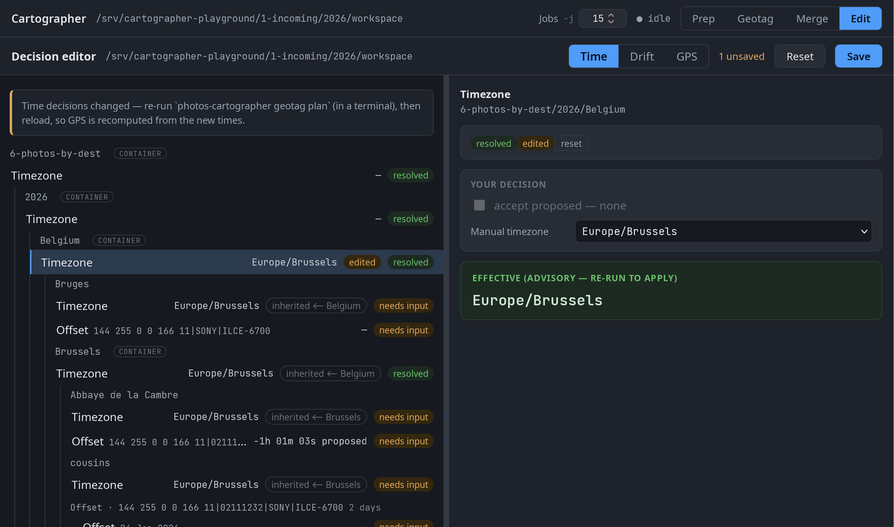
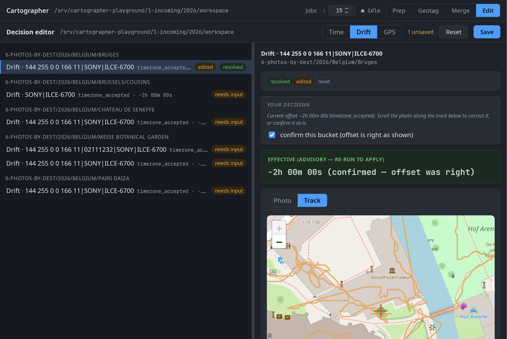
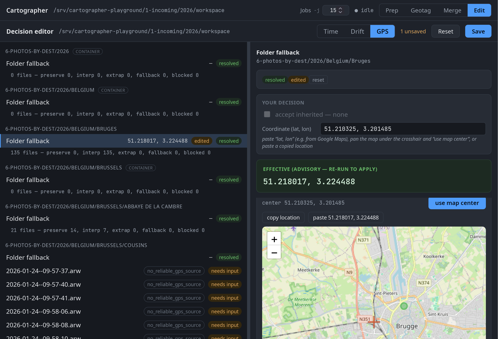
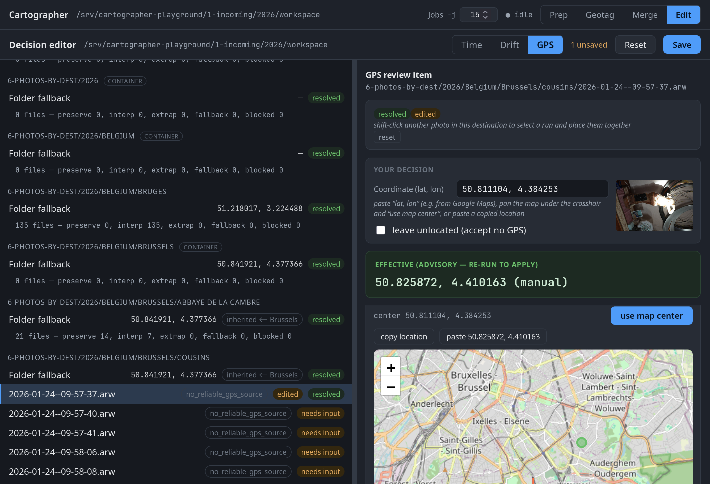

# Editor guide

The decision editor is a small single-page web app the pipeline serves locally. It's where you answer
the questions geotag can't decide on its own — timezones, clock offsets it won't apply by itself, and
photos nothing could place — each shown with its proposal and the evidence behind it. It writes those
answers back into the decision records geotag reads (`photos-21`, `photos-22` and `photos-23` in
`.photos-ingest/`).

This guide assumes you've reached the geotag loop in the [quick start](quickstart.md); the [concepts
guide](concepts.md) explains the ideas (camera groups, day buckets, drift, cascading) the views act on.

---

## Launching it

```bash
cd /path/to/workspace
photos-cartographer edit
```

Like every phase, `edit` operates on the **current-directory workspace** (no workspace-naming
argument). It refuses to start if the current directory isn't an initialized workspace, or is a sealed
(already merged) one. It serves on port **8765** by default (moving up to the next free port if that one
is busy) and binds all interfaces, so you can reach it from a laptop browser while SSH'd into a server —
it prints a clickable `http://<host>:8765/` link. Use `--host 127.0.0.1` for local-only, `--port N` to
choose a port. When bound to loopback, startup also prints a ready-to-copy `ssh -L …` tunnel command for
reaching it from your local machine. Only one editor can have a workspace open at a time; a second one
is refused and told who holds it. Stop it with Ctrl-C.

### In the console

`photos-cartographer console` has the same editor as its **Edit** tab, so you can plan geotag and edit
its decisions from one browser page. The Edit tab holds to the same rules: it won't open the editor on a
workspace that isn't initialized or is sealed, and it takes the one-editor lock the first time you open
it and keeps it until the console stops — meanwhile `photos-cartographer edit` on the same workspace is
refused, and the other way round.

When a `geotag plan` you started from the console's Geotag tab finishes, the Edit tab reloads by itself
to show the new records. **Save first**: the reload drops edits you haven't saved.

### Demo mode — zero setup

```bash
photos-cartographer edit --demo
```

A read-only tour on bundled example data — **no workspace, nothing written**. The fixtures, web assets,
and map library are all packaged inside the executable, so `--demo` works straight from the downloaded
release: it needs only a `python3` host and a browser. (No photo previews in demo — it touches no
workspace files. Map tiles and place search need internet.) It's the fastest way to see what the three
views look like before you have real data.

---

## The working loop

The editor edits decisions; it does **not** recompute the pipeline. The loop is always:

> **edit → Save → re-run `photos-cartographer geotag plan` → reload the page**

There is **no in-app "re-run" button**. Every gate and stale notice tells you to re-run in a terminal
(or from the console's Geotag tab) and reload. Until you do, anything the editor shows about *outcomes* —
the **Effective (advisory)** box, the inherited badges — is a preview; geotag computes the authoritative
result on the next run.

The editor only ever writes the **`user_decision`** field of each decision, round-tripping every other
field exactly as geotag produced it. The **Save** button is disabled while any field is invalid: a
timezone that isn't one, a zone that isn't one of the chosen country's, an offset that isn't a whole
number of seconds, a coordinate out of range or with only one half. **Reset** in the header throws away
every unsaved edit; the **reset** button on a decision throws away that one.

A save is refused, and **nothing is saved**, when:

- **a run is in progress** on the workspace (a save takes the workspace lock) — save again when it
  finishes;
- **the records changed on disk since the editor loaded them** — typically a `geotag plan` ran in the
  meantime. Your edits were made against decisions that are no longer the ones on disk, so the editor
  won't lay them over the new ones: reload the page to see the decisions as they are now, and make your
  edits again;
- **the workspace is sealed.**

A successful save names the files it wrote and reminds you to run `geotag plan` and reload.

**Coming from 2.0.0:** an offset you accepted under 2.0.0 didn't record which offset it accepted, so
`geotag plan` now stops on it. Open the editor: the decision says it was accepted for another proposal —
accept it again (or set the offset yourself), save, and re-plan.

---

## The three views, and why they're gated

The header toggles between **Time → Drift → GPS**, in that order — and the order is enforced:

- **Time gates Drift** — the Drift view waits until every time decision is answered and geotag has been
  re-run (drift checks offsets that must already exist).
- **Drift gates GPS** — the GPS view waits until every drift check is confirmed (a wrong, unchecked
  offset would place photos at the wrong point on the track).

If you edit a Time or Drift decision, the views after it show a "decisions changed — re-run `geotag
plan` and reload" notice until you do.

In every view each decision carries a status: **needs input**, **resolved**, **auto** (geotag answered it
itself), **stale** (your earlier answer no longer fits — see [How edits reset
things](#how-edits-reset-things)), or **none** (an optional folder fallback left unset). An edit you
haven't saved is badged **edited**, an invalid one **✗ invalid**.

---

## Time view

A recursive tree of your destinations. For each one you settle its timezone, and for each camera on each
day its clock offset. Container folders (those holding only sub-destinations) are badged `container` —
they never block; you answer on them only to pass a value down.



*Screenshot from v2.0.0: the "accept proposed" checkbox is gone, an inherited zone shown here as "needs
input" now applies itself unless the destination's photos speak against it, and the panel now also
offers an "In country" choice.*

### Timezone

A destination has **one timezone** for all its photos. You answer it once, high in the tree; everything
beneath inherits it.

- **Inherited** — a destination with no zone of its own takes the one of its nearest ancestor that has
  one, badged `inherited ⟵ <ancestor>`. It applies itself; the badge updates live as you edit
  ancestors.
- **In country** — say which country a folder is in (whatever the folder is called; it needn't be the
  country's own folder). A country with **one** timezone gives it to everything inside. A country with
  **several** gives none and lets none through from above: each destination inside answers for itself,
  and the **Manual timezone** list only offers that country's zones. A country is said **once, at the
  top of its tree**: below a folder that has one, the choice is locked and says where it was made, and
  choosing a country on a folder removes any country chosen inside it (the editor says which). The
  choice appears only when the host's timezone database lists countries.
- **The configured default** (`default_folder_timezone`) is only **offered**: a destination with nothing
  to inherit shows it with a **use** button, but it never applies by itself — so a trip abroad is never
  timed in your home zone. Inside a country, it is offered only if it is one of that country's zones.
- **Manual timezone** — pick an IANA zone from the dropdown. It overrides an inherited one and
  **re-roots the chain**: every destination beneath inherits it (until one of them overrides in turn).

**When the photos disagree with the zone.** Phone photos record the offset from UTC they were taken at.
When some of a destination's photos record an offset its zone didn't have at that time, the zone does not
take effect and the destination asks — and nothing inside it inherits through it. The panel says how many
photos, gives one as an example, and names both offsets. Either pick the zone the photos were taken in,
move the photos taken elsewhere into a folder of their own and re-run, or tick **keep `<zone>` for
these photos** if the device was simply set to another zone. That word covers the offsets listed; a photo
arriving later with yet another offset asks again.

### Clock offset

One offset decision per camera group per destination — per **day** when the group spans more than one
day there, since a camera reset each morning has a per-day offset. Phones get none: their time is
resolved per file. Offsets **never inherit** — each day stands alone, so no inherited badge appears on
them. See [why grouping is per-day](concepts.md#why-grouping-is-per-day-within-a-destination).

Days of one group with the same proposal are collapsed into one row (e.g. "3 Jul 2024 … 9 Jul 2024
(7 days)"); an answer there applies to every day in it. Click **▸** to show each day and answer one
separately.

You answer in one of two ways:

- **accept proposal (±Xh YYm ZZs)** — the button names the offset, and so does your answer. If a later run
  proposes a different offset, your acceptance no longer holds and the decision asks again: "Accepted when
  the proposal was X; it is now Y — accept it again, or set the offset."
- **manual offset** — your own value (camera time + offset = real UTC), set on the h/m/s spinner (scroll
  or ↑/↓ over a unit), in seconds in the box beside it, or — for a proposal found from GPS — as the
  **anchor real-UTC** of the proposal's example photo.

An **Impact** line shows what the offset does to a photo: its camera time → the corrected local time (and
UTC). **clear** removes your answer.

What the proposal panel shows depends on where the offset came from:

- **Found from GPS** — the camera's own geotagged photos matched against your GPX tracks. Up to three
  **correction groups** ("N photos → offset", each with an example photo, the track it matched and its
  corrected local time). The recommended group has **accept**; any other has **use this** — one click,
  for every day in the row. An offset picked from a group counts as found by the camera's GPS, so the
  Drift view won't ask about it. A confident proposal can apply itself (status **auto**) as configured;
  otherwise you're asked, with a note saying why:
  - **a tie between visits** — the photos fit several visits of the tracks equally: pick the group of
    the day you were there;
  - **the tracks stood still** — the GPS says where the photos were but not when; the offset shown is
    one that fits. Accepting it sends it through the Drift view to check;
  - **photos that agree with no group** — named. Scattered, their own positions are off: accept. The last
    of the day: the camera's clock changed — move them into a sub-folder and re-run.

  Photos skipped for having a track only outside the plausible time window, or none nearby, are counted.
- **Shared from the same day elsewhere** — no photo here has its own position, but the camera's GPS fixed
  its clock that day in another destination. Where it applied itself there it applies here too;
  otherwise accept it here or set another. If the camera's GPS gives two different offsets on one day in
  two destinations, neither takes effect: both are shown, and you set the right offset by hand in the
  one that is wrong.
- **Derived from the local time** — no GPS evidence, so the offset assumes the camera clock showed the
  destination's local time (daylight-saving aware, so summer and winter days differ). Accept it only if
  the camera really tracked local time — a camera left on home time would be wrong. Where GPX tracks
  cover these photos, there is **nothing to accept here**: the decision says to confirm it in the Drift
  view, against the tracks, once.
- **No proposal** — set the destination's timezone and re-run to get a local-time proposal, or enter the
  offset yourself. No local-time proposal is made when the photos' time falls at a **daylight-saving
  change** in that zone (a time that happened twice, or never): the zone gives two offsets there, and the
  proposal shows `timezone_ambiguous` with both. Set the offset yourself.

(A phone photo or other file whose own time falls at a daylight-saving change stops `geotag plan`
outright, naming the photo — that is fixed outside the editor; the terminal message says how.)

---

## Drift view

The drift view lists the offsets **the camera's own GPS has not fixed** — written by hand, derived from
the local time, or found from a track that stood still — wherever GPX tracks cover the photos. A wrong
offset there would place every photo of that day at the wrong point on the track, so each must be
**confirmed against the track** before the GPS view opens.

Each row shows the camera group, where its offset came from, the offset and the day. In the panel:

- **Photo** tab — **‹ prev / next ›** chooses the photo that stands for the bucket (with a preview).
- **Track** tab — slide that photo along its GPX track under a fixed crosshair until it lines up:
  **scroll the wheel** over the map to step one track point per notch, or press **`[` / `]`** (one point)
  and **`{` / `}`** (ten). Each step sets the corrected offset for every photo in the bucket and
  confirms it; **clear — offset was right** takes the correction back.
- **confirm this bucket (offset is right as shown)** — the "don't move" answer. You **must** actively
  tick it: an untouched bucket **blocks** the run; inaction is never read as "no change."

A confirmation names the offset it confirmed. If that offset changes — you edit the Time decision, or a
re-run proposes another — the bucket asks again: "Confirmed for X; the offset is now Y — check it on the
track and confirm again."

Confirming refines the offset without altering your Time decision; the corrected offset feeds the
recomputed times on the next run.



---

## GPS view

Per destination: a **folder fallback**, a worklist of only the photos nothing automatic could place, and
a summary line — files in total, how many keep their own GPS (`preserve`), are placed on or between
track points (`interp`), past a track's end (`extrap`), by the folder fallback, or still blocked. Geotag
marks every position it writes from the tracks as `matched`, `interpolated` or `extrapolated` in the
photo itself, so a rough position is never taken for a precise one.

Photos are placed in this order: the photo's own GPS → a coordinate you set for it → the tracks → the
folder fallback → left unlocated, if you said so → otherwise blocked.

**Folder GPS fallback** — a single coordinate that places any photo in that destination nothing above
it could. It cascades downward like the timezone (badged `inherited ⟵ <ancestor>`), but unlike the
timezone it is **never applied by itself and never blocks**: an inherited fallback is a proposal you
*may* take with **accept inherited**. A fallback you set **re-roots the chain** for the destinations
beneath. Photos it places are marked as such (`manual_fallback`), so it's always clear the position
wasn't measured. **clear** takes a fallback back (to *no fallback*; destinations beneath then inherit
from above again).



**Why a photo wasn't placed.** A worklist photo says, in one line, why the tracks didn't place it —
your lead to the fix before you reach for the map:

- no tracks to place it by;
- the nearest track point is too far from the photo's time;
- the track has a gap there;
- the track jumps too far, or too fast, between the two points around the photo;
- **tracks disagree** — two track files (or two tracks in one file) cover that time in places too far
  apart, and nothing says which one the camera was with. Take the track that isn't this trip's out of the
  tracks folder and re-run.

**Placing individual photos** on the map beside the photo (a thumbnail sits in the decision box; hover a
name in the worklist for a larger preview):

- **Paste `lat, lon`** straight from Google Maps into the coordinate field — it commits on paste and
  jumps the map to that point.
- **Search a place by name** (OpenStreetMap/Nominatim) — submit with Enter or the button; picking a
  result moves the map, then you "use map center" to set it.
- **Pan the crosshair** and "use map center" to drop a point by eye.
- **Copy / paste a location** between photos — "copy location" stashes the coordinate (and writes
  `lat, lon` to your system clipboard); "paste" applies it to the current photo. The next photo opens
  centred where you last placed one.
- **leave unlocated (accept no GPS)** — the photo stays without a position. It only counts where no
  folder fallback applies.



**Place many at once with shift-click:** click a photo to select it (and set an anchor), then
**shift-click** another *in the same destination* to select the contiguous run between them. One
location you set then applies to every photo in the run. (Shift-clicking into a different destination
starts a fresh selection — runs never cross destinations.)

---

## How edits reset things

Two reset behaviors worth knowing (both take effect on the next run):

- **Re-rooting** — setting a manual **timezone** or **folder fallback** on a folder makes it the new
  basis its descendants inherit, replacing whatever flowed from higher up. A descendant that set its own
  value keeps it (it overrides). A **country** works the same way, but only once per tree: a country
  chosen inside another country's folder is removed by the next run, which says so in the terminal and
  on the folder.
- **Restaling** — changing an upstream timezone, offset, drift confirmation or fallback makes what was
  computed from it (the corrected times, the GPS decisions, the executable plan) out of date;
  `geotag plan` recomputes it. Your decisions are **kept** while what they decide about is unchanged:
  a day's offset is found again by its day, a photo's coordinate by the photo itself, even after geotag
  renamed it. An answer whose question has changed is never silently applied to the new one — it is
  marked **stale** and asked again: an acceptance of an offset no longer proposed, a confirmation of an
  offset no longer in effect, an inherited fallback that no longer exists, a zone kept for photos when
  one arrives recording yet another offset.

---

## Quick reference

| Action | How |
|---|---|
| Launch on a workspace | `photos-cartographer edit` (port 8765), or the console's **Edit** tab |
| Zero-setup demo | `photos-cartographer edit --demo` |
| Apply your edits | Save → `photos-cartographer geotag plan` → reload |
| Save refused: records changed | reload the page, make the edits again |
| Say which country a folder is in | Time view → timezone → **In country** (once, at the top of its tree) |
| Answer a clock offset | **accept proposal**, a group's **use this**, or a manual offset |
| Step a photo along the track (Drift) | scroll wheel, or `[` `]` (Shift `{` `}` for ×10) |
| Confirm an offset as it is (Drift) | tick **confirm this bucket** |
| Set a coordinate (GPS) | paste `lat, lon`, place-name search, or pan + "use map center" |
| Place a run of photos | click, then shift-click another in the same destination |
| Copy a location to the next photo | "copy location" → "paste" |

What geotag guarantees about each decision — what applies itself, what waits for you, what is asked again —
is in the [specification](https://sigfridvonshrink.github.io/photos-cartographer/intent/geotag.html); the decision files' fields are in the
[decision-file reference](../cartographer/editor/decision-json-reference.md).
